# Tổng quan AI Team Control Room

Đối chiếu với `master` tại commit `072ccb2`, ngày 14/10/2026. Xem [README](../README.md) để chạy và cấu hình chi tiết.

## Mục đích

Control Room là dashboard local điều phối đội AI nhiều tài khoản Claude/Codex/Gemini làm song song trên nhiều project Git. Lead chia việc, các Builder làm trong worktree riêng, Controller chạy kiểm tra và thu bằng chứng; owner duyệt kế hoạch, nghiệm thu và quyết định merge local. Hệ thống không tự push remote. Node.js 24, SQLite tích hợp và giao diện HTML/JS/CSS không cần build.

## Phụ thuộc giữa job & hàng merge

Khi tạo job, chọn nhiều mục trong **Chờ job…** thuộc cùng dự án; trong chi tiết job chưa kết thúc, dùng **Sửa phụ thuộc** để thay đổi. API tạo job nhận `dependsOn: string[]`, control `set-depends` nhận `{ids}`. Không cho phép phụ thuộc chính mình, job khác dự án, job không tồn tại hoặc vòng phụ thuộc. Job cũ không có phụ thuộc giữ luồng hiện tại.

Điều kiện đạt là job phụ thuộc có trạng thái `merged`, có commit riêng và commit merge/revision là ancestor của `job.baseBranch`. Branch chưa có commit riêng không đủ điều kiện. Lead vẫn lập plan chỉ đọc; trước implement, controller giữ job với lý do **Chờ #X vào nhánh đích**, không gọi agent ở giai đoạn này. Khi đủ điều kiện, controller tự đồng bộ base và chạy tiếp; tọa độ plan cũ cần được dò lại theo symbol. Nếu phụ thuộc bị hủy hoặc xóa, hộp **Cần anh quyết định** cho phép bỏ phụ thuộc hỏng, hủy job hoặc chờ tiếp.

Khi duyệt plan, xem các job liên quan do Lead gợi ý và cảnh báo trùng file. Chọn **Chờ lần lượt** để gán phụ thuộc hoặc **Song song** cho từng mục. Không có lựa chọn được đánh dấu sẵn; gợi ý và cảnh báo không tự gán phụ thuộc.

Hàng merge được quản lý theo **(project, nhánh đích)**: mỗi cặp chỉ một job đang merge. Yêu cầu tiếp theo vào hàng, hiện vị trí và nút **Rời hàng**. Xác nhận merge của chủ được ghi khi xếp hàng, gồm xác nhận gõ tay ở rigor strict. Sau lượt trước, job tiếp theo phải đồng bộ và test lại trước khi tự merge theo xác nhận đã có. Nếu cần nghiệm thu bản đã sync, dashboard hiện trạng thái chờ nghiệm thu; conflict hoặc test fail đưa job ra khỏi hàng vào hộp quyết định.

### Giai đoạn 2 (chưa làm)

Phân tích ảnh hưởng mức symbol bằng GitNexus để phát hiện liên quan chính xác hơn, tự gán phụ thuộc và tách `src/team.js` là hướng phát triển tiếp theo, chưa thuộc giai đoạn này.

## Trạng thái Git, quyết định và dọn dẹp job

Dashboard dùng 7 trạng thái thống nhất: **Đang làm**, **Chờ chủ duyệt**, **Đã vào master**, **Kẹt merge**, **Hủy – còn code chưa vào master**, **Hủy – sạch**, **Xong**. Trạng thái được đối soát định kỳ và khi mở dashboard với Git thật bằng quan hệ tổ tiên trên nhánh chính, nên nhận diện cả merge tay ngoài dashboard. Repo liên kết được đối soát riêng; không suy ra tất cả repo đã merge từ kết quả của một repo.

Cấu hình `project.mainBranch` chọn nhánh chính, `project.integrationBranch` chọn nhánh tích hợp. Trong luồng dev + release-candidate (RC), AI tích hợp vào dev; job đã vào dev nhưng chưa lên master hiển thị **Chờ chủ duyệt (RC)**. Chủ duyệt RC trước khi đưa lên master; tích hợp vào dev chưa có nghĩa là đã vào master. Xem [thiết kế dev + RC](design/integration-flow.md).

Hộp **Cần anh quyết định** chỉ liệt kê job cần chủ hành động, mỗi job một dòng kèm lý do; badge/toast báo khi có mục mới. Lỗi merge được phân loại thành `base_moved` (base đã đổi: tự sync và chạy test lại), `conflict` (liệt kê file xung đột, cần người xử lý), và `tests_failed` (trả về builder sửa). Các xác nhận dùng popup trong trang.

Sau khi merge hoàn tất, hệ thống dọn branch và mọi worktree của job, kể cả `-review-*`; worktree bẩn không bị xóa. Khi hủy/xóa, trước khi xóa branch phải tạo tag `archive/<branch>` với phần tên bỏ tiền tố `ai-team/`, gồm cả branch con `-tN` và `-wip-tN` (ví dụ `ai-team/abc-t1` được lưu thành `archive/abc-t1`). Xóa job còn code chưa vào master cần xác nhận archive rõ ràng để có thể khôi phục.

Trang **Mồ côi** liệt kê branch `ai-team/*` và worktree không thuộc job nào, kèm cờ đã vào master/chưa và ngày commit cuối. Chủ chọn xóa một lượt; branch chưa vào master được archive trước, worktree bẩn được giữ lại. API: `GET /api/orphans` để xem danh sách, `POST /api/orphans/delete` để xóa các mục đã chọn.

Tên Git theo task: branch `ai-team/<id>-<slug>`, commit `<tiêu đề task> (<member>)` với tác giả là member AI, merge commit `Merge: <tiêu đề> [#<id>]`. Merge nội bộ giữa các sub-task cũng dùng tiêu đề sub-task thay cho mã T1/T2. Bộ test tạo branch/worktree trong repo tạm và tự dọn sau khi chạy, không còn đụng repo thật.

## Luồng công việc

```mermaid
flowchart LR
  A[Tạo job] --> B[Định tuyến auto / fast / full]
  B --> C[Lead lập plan]
  C --> D[Challenger phản biện nếu high / strict]
  D --> E[Owner duyệt kế hoạch]
  E --> F[Implement song song trong worktree con]
  F --> G[Controller chạy test]
  G --> H[Review]
  H --> I[Verify]
  I --> J[Preview / owner nghiệm thu]
  J --> K[Owner duyệt merge]
```

- Đây là luồng đầy đủ; code hiện tại phản biện **trước** duyệt kế hoạch để owner duyệt bản đã sửa. Phản đối medium/high đưa về Lead sửa một lần, không phản biện lại.
- `auto` dùng luật chọn fast path cho mục tiêu ngắn, ít rủi ro; `fast` có thể bỏ plan và leo thang về Lead khi cần. `full` dùng Lead. Job code có plan mặc định phải được duyệt đúng version/hash trước implement; vòng sửa cũng cần duyệt lại nếu cấu hình không tắt.
- `rigor: light`: việc dễ, risk low, task độ khó ≤ 2; test, thường bỏ AI review/verify. `standard`: test + review; verify khi được yêu cầu hoặc cổng rủi ro buộc chạy. `strict`: review + verify, risk high và xác nhận commit khi merge. Lead đề xuất `flow.steps`; Controller vẫn ép bước cần cho rủi ro/tranh chấp, test code luôn chạy.
- Task độc lập, không trùng `files`, được chạy song song rồi gộp worktree con trước test; conflict làm job blocked. Task `kind: review` có thể kiểm ngay các task phụ thuộc, sửa và review lại tối đa 2 lần trước khi trả Lead.
- Test/review/verify yêu cầu sửa → quay về plan; `maxReworkRounds` mặc định 3. Hết vòng mà còn finding high → chờ owner quyết. Finding bị Builder bác bỏ phải có bằng chứng và Verifier phân xử.
- Job `kind: research` chỉ đọc, không sửa repo, không chạy luồng test/preview/merge code; kết thúc bằng kết luận. Research và fast path chưa có plan không cần duyệt kế hoạch.
- READY chỉ cho phép quyết định khi các kiểm tra cần thiết khớp revision. Project có preview mặc định cần owner nghiệm thu đúng revision; preview lỗi được ghi cảnh báo. Base đổi phải sync và kiểm lại; merge phân kỳ cần test commit merge và duyệt lần hai.

## Vai trò và đội hình

| Vai trò | Trách nhiệm |
|---|---|
| Lead / Manager | Đọc mục tiêu/code, hỏi khi thiếu yêu cầu, chia task và phụ thuộc, chấm độ khó/rủi ro, chọn flow, tổng kết và cập nhật memory. |
| Builder | Chỉ làm task được giao trong quyền đã cấp, báo contextGaps, checkpoint và bằng chứng. |
| Reviewer | Đánh giá diff đúng base/revision hoặc kết luận research, trả verdict và findings có cấu trúc. |
| Verifier | Đối chiếu mục tiêu, kiểm chứng kết quả và phân xử findings bị bác bỏ. |
| ChatGPT web | `oracle: {mode, enabled, accounts:[{id}], baseUrl, headless, chrome?, timeoutMin, maxPerJob}`: `mode` là `off` / `auto` / `required`, mặc định chuyển từ `enabled` cũ; job ghi đè bằng `oracleMode`. Chế độ `required` hỏi tự động một lần trước plan, lưu marker để resume/rework không gửi lại; lỗi vẫn cho Lead lập plan. Mỗi tài khoản (1–2) có profile trình duyệt riêng trong `<dataDir>/chatgpt-profiles/<id>`; `chrome` là đường dẫn Chrome/Edge nếu không tự tìm thấy, `headless` chỉ dùng cho test; `command`/`args` của CLI cũ được bỏ qua. `model` (hoặc `accounts[].model`) là tên model hiển thị trong menu model của ChatGPT, vd `Instant` / `Thinking` / `Pro`, chọn bằng cách bấm menu đó trước khi hỏi (đặt được trên dashboard; trống = giữ model đang chọn; tên không có trong menu → lỗi kèm danh sách tên có); `timeoutMin` giới hạn thời gian hỏi (thử kết nối tối đa 2 phút), `maxPerJob` giới hạn số lượt trong job (gồm lượt tự động). Đăng nhập lần đầu qua `POST /api/oracle/login {account}` (nút **Đăng nhập ChatGPT** trong hộp Thử kết nối, mở cửa sổ ChatGPT hiện); thử kết nối từng/mọi tài khoản qua `POST /api/oracle/test`; thống kê qua `GET /api/oracle/stats`. Timeline giữ `ORACLE_QUESTION` / `ORACLE_ANSWER`, thêm `ORACLE_ERROR` và mã lỗi. |
| Controller | Phần mềm điều phối: định tuyến, quota/slot, Git/worktree, test, cổng duyệt, lưu SQLite, evidence và merge sau owner duyệt. |

Đội hình lấy từ các trường không bí mật của `D:\work_team\team.config.json` ngày 14/10/2026; `pipeline` gán vai trò, tier là năng lực mặc định (effort cao có thể tăng mức phù hợp):

| Tier | Member | Provider | Vai trò hiện tại |
|---|---|---|---|
| strong | `claude-86a9ac9c` (Mailue-CL) | Claude | Manager |
| normal | `codex-1` (Nahin-C) | Codex | Builder |
| normal | `codex-2` (Lobao-C) | Codex | Builder / Verifier |
| weak | `codex-3` (Ymimi-C) | Codex | Builder |
| weak | `gemini` (Gehihi-G) | Antigravity / Gemini | Reviewer |

Member có thể được thay tạm khi quota thấp; checker ưu tiên người không viết code và khác provider. Owner đổi đội hình/model/prompt trong màn Quota & tài khoản. File mẫu dùng `claude-1` thay cho ID Claude của máy này.

## Chức năng hiện có trên master

- **Phản biện plan** (`challenge`: `all` mặc định / `high` / `off`): sau khi Lead lập plan cho job code, một member khác kiểm tra plan với code thật (có công cụ đọc repo) trước khi builder làm. Plan rủi ro cao: người phản biện thường (khác CLI với Manager nếu được). Rủi ro thấp/vừa: phản biện nhanh bằng member Claude chạy `challengeModel` (mặc định `haiku`), không có Claude thì member khác ở mức suy luận thấp nhất. Phản đối không phải mức thấp đưa plan về Lead lập lại (một lần). Kết quả ở `job.challengeResult`, hiện ở node **Phản biện plan** trên sơ đồ.
- ChatGPT web đóng vai **tech lead bên ngoài**: góp ý hướng đi khi plan có lựa chọn thật (cách làm/kiến trúc nào hợp hơn, thư viện/công nghệ nào, đánh đổi, cạm bẫy; cả câu hỏi thiết kế/câu chữ). Không thấy repo: không còn hỏi tự động trước plan cho job code (chỉ job nghiên cứu); Lead tự hỏi bằng `consult` sau khi đọc code, câu hỏi tự chứa (stack, ràng buộc tìm được, các phương án A/B và cái giá của từng cái). Kiểm tra plan với code là việc của bước phản biện.
- Lead tham khảo ChatGPT web bằng trình duyệt có sẵn trên máy (`src/chatgpt-web.js` điều khiển Chrome/Edge qua CDP, cửa sổ chạy ngoài màn hình), dùng quota web, chỉ ở bước plan (kể cả vòng rework). ChatGPT chỉ tư vấn, không nhận task hay sửa code. Có thể hỏi tiếp trong cùng cuộc trò chuyện của một job; câu hỏi/câu trả lời lưu trong lịch sử job, toàn văn thu gọn khi xem job. Mỗi tài khoản dùng một browser profile riêng, đăng nhập thủ công một lần; mỗi tài khoản chỉ có một cuộc hỏi tại một thời điểm, job khác chờ. Lỗi/timeout/captcha/chưa đăng nhập/Too many requests thì Lead bỏ qua, ghi WARNING và tiếp tục bình thường.
- Oracle API: `GET /api/state` trả `oracle: {enabled, mode, accounts: number, accountIds: string[], maxPerJob}`; `POST /api/settings` nhận `{oracle: "off"|"auto"|"required"}` (hoặc boolean cũ) và trả `{language, oracle}` cùng shape. `POST /api/jobs` nhận thêm `oracleMode` và `lang` (`vi` / `ja` / `en`) tùy chọn; control action `language` nhận `payload.lang` để ghi đè ngôn ngữ job. `POST /api/oracle/test` nhận `{account?: id}`, không chọn thì chạy tuần tự mọi tài khoản, kể cả khi mode `off`; trả `{results:[{account,ok,answer?,error?,code?,ms,at}]}`. Test dùng câu hỏi cố định, cùng hàng đợi với Lead, không ghi job hay tính thống kê. Lượt hỏi job lưu `{q,at,account,auto?,a?,error?,code?,ms?,waitMs?}`; `ms` không gồm thời gian chờ hàng đợi. Lead có thể ghi lý do không hỏi vào `oracleSkip`, lưu thành `job.oracle.skipReason` đã redact (tối đa 300 ký tự).
- `GET /api/oracle/stats?from&to&project&job` nhận mốc ISO, mặc định 7 ngày gần nhất, tính khoảng `[from,to)`. Kết quả `{from,to,timezone,totals,byDay,byJob,byProject}`; mỗi nhóm có `{asks,ok,failed,avgMs,auto}`, `byDay` thêm `key: YYYY-MM-DD`, `byJob` thêm `{key,title,project}`, `byProject` thêm `key`. Ngày theo `config.timezone` (mặc định `Asia/Tokyo`), `avgMs` chỉ tính lượt có `ms` (0 nếu chưa có), nhóm ngày tăng dần và nhóm job/dự án giảm dần theo số lượt. Lỗi chuẩn hóa: `not_logged_in` (gồm hết phiên), `timeout`, `captcha`, `rate_limited`, `disabled`, `error`. Câu hỏi tự động chỉ chứa project id, loại việc, tiêu đề và tối đa 2000 ký tự goal đã redact; không lấy nội dung file hay config.

Builder có thể hỏi ChatGPT web ở bước research, và ở bước implement khi `job.kind` là `research`, bằng cách trả `status: "consult"` với `consult: {"question"}`. Các lượt của Lead và builder dùng chung giới hạn của job; khi hết lượt hoặc Oracle lỗi, builder tự đọc tiếp và job không bị chặn. Job research ưu tiên hỏi ChatGPT web trước; `oracle.researchMode` mặc định là `required` (có thể đặt `auto` hoặc `off`), còn `oracle.maxPerResearchJob` mặc định là 8 và thay `maxPerJob` cho loại job này. `job.oracleMode` ghi đè cả `oracle.mode` và `oracle.researchMode`. Thống kê Oracle tách số lượt theo vai Lead/builder và hiển thị ước tính tiết kiệm: số lượt gọi AI tránh được = số lượt builder hỏi thành công; token tránh được = số lượt đó × lượng token trung bình mỗi lượt builder. Các số tiết kiệm này chỉ là ước tính.

Cột Job ghi ID 8 ký tự đã đối chiếu lịch sử master và SQLite. `—` nghĩa là chức năng nền từ v1/v1.1 (01/10/2026) hoặc thay đổi cũ không có ID job trong commit; không suy đoán ID từ tên commit `new`/`test`. Bảng chỉ mô tả chức năng đã có trong code, không coi đề xuất trong báo cáo là tính năng.

| Chức năng | Dùng ở đâu (UI/API/MCP/config) | File chính | Job |
|---|---|---|---|
| Setup máy mới, demo với provider mock | CLI `npm run setup`, `npm run demo` | `src/setup.js` | — |
| Dashboard local, xác thực controller, cập nhật SSE | UI; API `/state`, `/stream`; config port | `src/server.js`, `public/app.js` | — |
| Ngôn ngữ Việt / Nhật / Anh | UI/controller dùng config `language`; từng job dùng `job.lang` | `src/i18n.js`, `src/team.js`, `locales/*.json` | — |
| Đăng ký, sửa, xóa project; chọn thư mục và tests | UI; API `/projects` | `src/accounts.js`, `src/server.js` | — |
| Phiên theo project, tên/ghi chú, xóa phiên | UI; API `/sessions` | `src/team.js`, `public/app.js` | — |
| Tạo job, mục tiêu, đính kèm ảnh/log/tài liệu | UI; API `/jobs`; MCP `delegate_task` | `src/team.js`, `src/mcp.js` | — |
| Tiêu đề ≤ 60 ký tự, Lead đặt tên, owner đổi tên, tìm/lọc danh sách gọn | UI; API control `rename`; MCP `rename_task` | `src/team.js`, `public/app.js`, `src/mcp.js` | `0daac6de` |
| Định tuyến auto/fast/full, fast path và leo thang | UI/API; MCP `delegate_task` | `src/team.js` | — |
| Lead lập DAG task, độ khó, effort, context, phụ thuộc và flow | UI sơ đồ; report JSON; config pipeline | `src/team.js`, `public/app.js` | — |
| Duyệt kế hoạch đúng version/hash, góp ý, lịch sử tối đa 20 bản | UI/API control `approve-plan`; config | `src/team.js`, `public/app.js` | `fe14daf8` |
| Challenger cho high/strict, findings, disputes, rulings và metrics | UI timeline; report JSON | `src/team.js`, `public/app.js` | — |
| Review node trong DAG và sửa riêng node tối đa 2 lần | UI sơ đồ; plan `tasks[].kind` | `src/team.js`, `public/app.js` | — |
| Chọn người theo tier/độ khó/effort, quota và tốc độ đo được | UI/API trạng thái; config agents | `src/team.js` | — |
| Task/job song song, worktree con, chống trùng file, checkpoint Git | UI timeline; config resources | `src/team.js`, `src/process.js` | — |
| Author checkpoint theo member, merge/sync theo Controller | Git; UI timeline/diff | `src/team.js` | `a758eeb5` |
| Controller chạy tests; review/verify độc lập, sửa có giới hạn | UI/API; config `projects[].tests`, rigor | `src/team.js`, `src/providers.js` | — |
| Pause/resume/cancel, xóa job, đổi người, nhắn góp ý, kiểm lại | UI/API control; MCP `control_task`, `send_message` | `src/team.js`, `src/mcp.js` | — |
| Timeline hoạt động CLI, báo cáo, diff và xuất Markdown | UI/API `/events`, `/diff`, `/export`; MCP `read_messages` | `src/team.js`, `public/app.js` | — |
| Hỏi đồng đội direct/independent/off, checkpoint và owner trả lời | UI/API; report peerRequest/dialogueDecision | `src/team.js`, `src/discussions.js` | — |
| Sổ claim/evidence, fingerprint, nghĩa vụ mở, gán lại sau chuyển máy | UI/API control `resolve-discussion`; report | `src/discussions.js`, `src/team.js` | — |
| So sánh ba chế độ cùng trần token/lượt gọi; owner chấm claim | UI/API `/comparisons`, control `score-claim` | `src/team.js`, `public/app.js` | — |
| Thêm member, bật/tắt, vai trò, model, effort, prompt, MCP riêng | UI/API `/members`; config agents/pipeline | `src/accounts.js`, `src/providers.js` | — |
| Đăng nhập CLI riêng, mở terminal, refresh trạng thái tài khoản | UI/API member login/terminal; scripts | `src/accounts.js`, `src/login-terminal.js` | — |
| Đọc quota thật, lịch sử, health/mood member; UNKNOWN khi chưa biết | UI/API `/quota`, `/quota-history`; config ngưỡng | `src/providers.js`, `src/team.js`, `public/app.js` | — |
| Tự thay mọi vai trò khi quota thấp, handover Builder, tự requeue khi hồi | UI/API control assign; config auto replace | `src/team.js`, `public/app.js` | `64c59397` |
| Retry lỗi 503/mạng, cooldown provider, thay provider và tự thử lại | UI timeline; config transient retry/cooldown | `src/team.js`, `public/app.js` | `64c59397` |
| Giới hạn RAM/CPU/slot, nhiều lượt cùng account, ngân sách token/call | UI tài nguyên; config resources/maxJobs/budget | `src/team.js`, `src/providers.js` | — |
| Quyền thư mục/read-edit-delete, shell, mạng; project/phiên và trần vai trò | UI/API access/role-caps; config | `src/accounts.js`, `src/team.js`, `src/providers.js` | — |
| Leader đề xuất quyền tối thiểu, owner lưu bản nháp | UI/API `/access/propose` | `src/team.js`, `src/accounts.js` | — |
| Sửa repo liên kết, worktree/test/check và merge nhiều repo | UI/API access; config `access.repos` | `src/team.js`, `src/providers.js` | — |
| Quét thư viện skill, Lead chọn, copy skill vào worktree | UI/API `/skills`; config skillDirs | `src/skills.js`, `src/team.js` | — |
| Memory project/job, tóm tắt phiên, FTS5, nguồn/revision/fingerprint | UI 🧠; API `/memory`, `/memory/search` | `src/memory.js`, `src/team.js` | — |
| Memory MCP chỉ đọc, giới hạn theo lượt/project/job; resume Codex tùy chọn | MCP `memory_search`, `memory_get`; config | `src/memory-mcp.js`, `src/providers.js`, `src/team.js` | — |
| Sao lưu SQLite tự động/thủ công, giữ lịch sử và xuất/nhập memory | UI/API `/backup`, `/backups`, `/memory/import` | `src/team.js`, `src/memory.js` | — |
| Chuyển việc giữa máy bằng bundle/diff/checkpoint/memory | UI/API `/transfer/import`, job `/transfer` | `src/transfer.js` | — |
| MCP điều khiển: trạng thái, tạo/đọc/nhắn/đổi tên/pause/resume/cancel/review | MCP stdio; API controller | `src/mcp.js` | `0daac6de` |
| Chọn branch gốc và đích, branch mới, merge-check, duyệt merge phân kỳ | UI/API branches/merge-check/merge; MCP baseBranch | `src/team.js`, `src/mcp.js` | `0a1f796d` |
| Sync base, xử lý conflict, chặn marker, test đúng commit, xác nhận rủi ro | UI/API control sync/merge; config sensitivePaths | `src/team.js` | — |
| Hồ sơ test/review/verify, lưu/đọc ảnh/log/HTML evidence theo revision | UI/API evidence/evidence-file | `src/evidence.js`, `src/team.js`, `src/server.js` | `0a1f796d` |
| Tab Kết quả: mục tiêu, thay đổi, bằng chứng, quyết định; giữ nội dung khi SSE | UI inspector | `public/app.js`, `src/team.js` | `5fe43a54`, `a758eeb5` |
| Preview trước/sau, ảnh desktop/mobile, TTL, dừng; Lead đề xuất cấu hình | UI/API preview/propose và control preview-start/stop | `src/preview.js`, `src/team.js` | `5fe43a54` |
| Nghiệm thu đúng revision, ba mức kết quả và cổng acceptance khi merge | UI/API control accept; config requireAcceptance | `src/team.js`, `public/app.js` | `5fe43a54` |
| Phục hồi restart về paused, giữ slot PID còn sống, dọn Git việc đã xong | Controller; UI trạng thái | `src/team.js`, `src/process.js` | — |

## Cấu trúc mã nguồn

- `src/accounts.js`: tài khoản, đăng nhập, profile/model, project và cấu hình quyền.
- `src/discussions.js`: ledger hội thoại peer, claim/evidence/decision và nghĩa vụ.
- `src/evidence.js`: phân loại và thu file bằng chứng theo đường dẫn/kích thước cho phép.
- `src/i18n.js`: chọn ngôn ngữ và dịch thông báo backend.
- `src/login-terminal.js`: tiến trình terminal đăng nhập tài khoản.
- `src/mcp.js`: MCP stdio điều khiển Controller qua API; không có tool merge.
- `src/memory.js`: kho memory SQLite, FTS5, revision và fingerprint nguồn.
- `src/memory-mcp.js`: MCP tìm/đọc memory theo phạm vi lượt gọi.
- `src/preview.js`: kiểm cấu hình, cổng trống, chạy/dừng preview và chụp Chrome.
- `src/process.js`: spawn, Git và timeout lệnh (mặc định 30 phút).
- `src/providers.js`: adapter Codex/Claude/Antigravity/Gemini, quota và sandbox.
- `src/server.js`: HTTP/API/SSE/assets, lock/token và khởi tạo Team.
- `src/setup.js`: tạo cấu hình/home khởi đầu và demo.
- `src/skills.js`: tìm thư viện và đọc metadata skill.
- `src/team.js`: máy trạng thái job, điều phối, SQLite, worktree, kiểm tra và merge.
- `src/transfer.js`: xuất/nhập việc, Git bundle và file đang sửa.
- `public/app.js`: trạng thái UI, sơ đồ, inspector, thao tác và SSE.
- `public/index.html`: khung dashboard và dialog.
- `public/style.css`: bố cục, thành phần, màu và responsive.
- `test/`: system integration, smoke, quota-failover và transient-failover.
- `locales/`: `vi.json`, `ja.json`, `en.json` cho giao diện và thông báo controller; khi có bản dịch, controller ưu tiên locale theo `job.lang` cho thông báo thuộc job.
- `scripts/`: `login.ps1`, `member-login.ps1` hỗ trợ đăng nhập member.

## Dữ liệu được lưu ở đâu

- `config.dataDir`, mặc định `<repo>/.team/state`; máy này: `D:\ai_team\.team\state`. `team.sqlite` chứa `jobs` (`body` JSON snapshot), `events`, `sessions`, `quotas`, `quota_history`, `member_stats`, `memory` và chỉ mục `memory_fts`. Memory dùng cùng DB qua `src/memory.js`, không có DB vector riêng.
- `<dataDir>/backups/team-*.sqlite`: bản sao SQLite; `backupDir` có thể đổi, `backupKeep` mặc định 14. `controller.token` và `controller.lock`: xác thực local và PID Controller; không đưa lên Git hay chép vào tài liệu.
- `<dataDir>/login/`: kết quả phiên đăng nhập; `worktrees/`: worktree job và worktree con/tạm. Job lưu branch/base/revision và các báo cáo, discussion, checkpoint trong JSON.
- `.ai-team/evidence/` trong repo/worktree (git-ignored): agent lưu ảnh/log/report; Controller thu và lưu hồ sơ dưới `<dataDir>/evidence/<job>/`, gắn stage/member/revision. Đính kèm mục tiêu nằm trong `<worktree>/.ai-team/attachments/`.
- Home member: `C:\Users\user\.ai-team\accounts\<id>` cho profile CLI; Codex slot dùng `sqlite-N`, đọc quota dùng `sqlite-quota`. Quota đã quan sát/lịch sử nằm trong `team.sqlite`, không phải hạn mức riêng cho từng slot. Antigravity dùng đăng nhập chung của máy, không có home riêng như Codex.
- Cấu hình máy ở `D:\work_team\team.config.json`; cấu hình mẫu trong repo không chứa đăng nhập. Worktree không tự nhận `.env`, credentials hoặc `node_modules` từ source checkout.

## Config quan trọng

| Nhóm | Khóa và ý nghĩa |
|---|---|
| Controller | `port` (3333), `dataDir`, `demo`, `language` (vi/ja/en) là ngôn ngữ mặc định của UI/server, tách biệt với `job.lang`. |
| Đội hình | `agents[]`: id/provider/command/home/enabled/model/tier/kind/effort/systemPrompt/MCP; `pipeline`: manager/reviewer/verifier/builders. |
| Project | `projects[]`: id/path/tests (argv tin cậy), access/network/readDirs, preview. Quyền theo phiên và `roleCaps` giới hạn quyền thực tế. |
| Kế hoạch/sửa | `planApproval`, `planApprovalRework` mặc định true; `maxReworkRounds` 3; `peerDialogue` true, job `dialogueMode`; `resumeCodexTasks` false trong mẫu. |
| Tài nguyên | `resources.reserveGB` 4, `ramPerAgentGB` 1.5, `maxAgents` 3; `hardStopRamPercent` mặc định max(90, maxRamPercent); `maxCpuPercent` 90. Đây là ngưỡng mở lượt mới. |
| Account/quota | `maxJobsPerAccount` hoặc agent `maxJobs` (1–8, mặc định 1); `minRemainingPercent` 15; `quotaPercentPerMinute` 0.3; `allowAutoReplacePinned` mặc định cho phép. |
| Lỗi tạm thời | `transientRetryDelaysMs` mặc định 60000/180000/600000 (tối đa 3); `transientCooldownMs` 900000. Cooldown provider chỉ ở RAM. |
| Ngân sách | `maxTokensPerJob` không đặt = không giới hạn; job/comparison có tokenBudget/callBudget, kiểm giữa lượt CLI. |
| Merge | `sensitivePaths` regex, `largeDiffLines` 300; cổng rủi ro có thể ép review/verify và yêu cầu gõ commit. |
| Preview | Project `preview`: command/readyPath/routes/timeoutSec/ttlMin/portRange/requireAcceptance; mặc định 120 giây, 30 phút, 4100–4199, cần nghiệm thu. |
| Memory/backup/skill | `maxMemoryFacts` 60; `backup` mặc định bật, `backupDir`, `backupKeep` 14; `skillDirs` thêm thư viện. |
| Provider/quyền | `codexWindowsSandbox` mẫu `unelevated`; `none` giảm cách ly. `agyAutoApprove: true` tự duyệt công cụ; `quotaPrintSupported` chỉ bật khi CLI hỗ trợ. |

Các giới hạn cần nhớ: không benchmark chất lượng AI; quota Gemini CLI chưa tích hợp; preview chỉ hỗ trợ web và không phải sandbox bảo mật; repo liên kết chưa tự sync khi base đổi; chuyển máy hiện chỉ một repo. Memory/báo cáo là dữ liệu cần kiểm nguồn, không phải quyết định đã được owner duyệt.

Mỗi job tự nhận diện `job.lang` từ goal: ký tự tiếng Việt có dấu chọn `vi`, kana/kanji chọn `ja`, còn lại chọn `en`; giá trị `lang` khi tạo job hoặc control action `language` có thể ghi đè. Tin nhắn mới nhất của owner cập nhật ngôn ngữ khi nhận diện đủ tin cậy: `vi`/`ja` cần ký tự đặc trưng, còn `en` cần câu ASCII tự nhiên dài ít nhất 40 ký tự và 6 từ. Chuỗi ASCII ngắn, đường dẫn, hash và log không làm đổi ngôn ngữ. Mọi prompt đều nhắc member viết phần văn bản cho người đọc bằng `job.lang` (code, identifier, commit message và đường dẫn giữ nguyên). Báo cáo dài nhưng rõ ràng sai ngôn ngữ được yêu cầu viết lại đúng một lần; nếu vẫn sai, controller ghi cảnh báo nhưng không chặn job.

## Điều khiển từ xa: Chatwork / Telegram / tunnel

- **Bot tin nhắn** (`src/bot.js`, bật khi có `bot` trong config): Chatwork (ưu tiên) và Telegram đều dùng **polling** nên không cần tunnel hay IP công khai. Token đặt ở biến môi trường `CHATWORK_TOKEN` / `TELEGRAM_BOT_TOKEN` (hoặc `bot.chatwork.token` / `bot.telegram.token` trong `team.config.json`, file này không commit). Chỉ `allow` (Chatwork account_id, Telegram chat id) mới ra lệnh được; tin của người khác bị bỏ qua. Chatwork để `allow` rỗng là chế độ cài đặt: bot báo nó chạy bằng tài khoản nào và trả lời mỗi người nhắn account_id của họ, không thực hiện lệnh nào.
- Lệnh luôn bắt đầu bằng `/` (tin không có `/` là yêu cầu viết tự do): `/status`, `/can` (việc cần bạn), `/jobs [dự án]`, `/job <id>`, `/ketqua <id>` (kết quả để duyệt từ xa), `/new [dự-án:] <mục tiêu>`, `/duyet <id>` (duyệt plan), `/msg <id> <nội dung>` (chỉ dẫn/trả lời Lead), `/pause|/resume|/cancel <id>`, `/merge <id> [mã xác nhận]`, `/quota`, `/help`. Mã job chỉ cần 4+ ký tự đầu. Bot tự báo khi job chuyển sang cần bạn (duyệt plan, Lead hỏi, vướng, sẵn sàng merge) hoặc đã xong. Chỉ xử lý khi server đang bật: tin gửi lúc server tắt bị bỏ qua, job xong lúc server tắt không báo lại khi bật (xem trên dashboard).
- **Ảnh/file gửi kèm** (Chatwork `[download:id]`, Telegram ảnh/tài liệu, ≤ 15 MB, tối đa 10): bot tải về và gửi cùng việc kế tiếp của cuộc chat (giao mới, chỉ dẫn, trả lời Lead, `/new`, `/msg`); agent đọc được ảnh trong `.ai-team/attachments`. Chỉ gửi ảnh thì bot chờ tin nhắn mô tả; file chờ quá 30 phút bị bỏ.
- **Kết quả để duyệt từ xa** (`/ketqua <id>`, tự gửi khi job sẵn sàng merge hoặc job nghiên cứu xong): mục tiêu, kế hoạch, từng task kèm tóm tắt kết quả, test của controller, review/verify của revision hiện tại cùng các điểm chưa xử lý, lý do cần chú ý, danh sách file đổi với số dòng (không gửi diff) và lệnh `/merge`; đính kèm trước tiên tối đa 5 file kết quả (docx/xlsx/pptx/pdf/csv/md: job nghiên cứu lấy từ bằng chứng, job code lấy file đã thêm/sửa trong worktree), rồi tối đa 8 ảnh (preview trước/sau trước tiên) và 2 báo cáo HTML từ bằng chứng của revision đó, mỗi file ≤ 5 MB.
- **Yêu cầu viết tự do** (`src/intake.js`): tin nhắn không phải lệnh được phân tích thành hành động (làm tiếp job, giao job mới theo dự án, trả lời Lead, xem tổng quan, hoặc chỉ là trò chuyện: chào hỏi, hỏi đáp không giao việc thì bot trả lời như chatbot bình thường) bằng model rẻ: mặc định Claude Haiku (`bot.intakeModel`, mặc định `haiku`, dùng tài khoản của member Claude đầu tiên còn quota), Claude hết quota hoặc lỗi thì tự chuyển sang member Gemini; prompt kèm ảnh chụp trạng thái (dự án, job đang mở, câu hỏi Lead). Tất cả đều lỗi thì dùng luật đơn giản (mã job → làm tiếp, Lead đang hỏi → trả lời, tên dự án trong câu). Mọi mã job/dự án được kiểm lại; chỗ chưa rõ (dự án nào, mã trùng nhiều job) bot hỏi lại bằng lựa chọn đánh số, rồi tóm tắt và chờ `y`/`n` trước khi làm. Câu hỏi của Lead được gửi nguyên văn vào chat, trả lời thẳng không cần `msg`. `bot.intake: false` để chỉ dùng luật, không gọi model.
- **Dashboard qua tunnel** (`remote.hosts`): request có Host nằm trong danh sách được chấp nhận với Origin `https://<host>`; trang `/` hiện ô nhập **khóa truy cập** (`<dataDir>/remote.key`, tạo tự động, chỉ đọc trên máy) thay vì tự cấp cookie như ở `127.0.0.1`; đăng nhập đúng nhận cookie `HttpOnly; Secure; SameSite=Strict` 30 ngày; sai quá 10 lần/15 phút bị chặn tạm. Nên đặt thêm Cloudflare Access (đăng nhập email) trước tunnel.

