# Tổng quan AI Team Control Room

Đối chiếu với `master` tại commit `072ccb2`, ngày 14/10/2026. Xem [README](../README.md) để chạy và cấu hình chi tiết.

## Mục đích

Control Room là dashboard local điều phối đội AI nhiều tài khoản Claude/Codex/Gemini làm song song trên nhiều project Git. Lead chia việc, các Builder làm trong worktree riêng, Controller chạy kiểm tra và thu bằng chứng; owner duyệt kế hoạch, nghiệm thu và quyết định merge local. Hệ thống không tự push remote. Node.js 24, SQLite tích hợp và giao diện HTML/JS/CSS không cần build.

## Luồng công việc

```mermaid
flowchart LR
  A[Tạo job] --> B[Định tuyến auto / fast / full]
  B --> C[Lead lập plan]
  C --> D[Challenger phản biện nếu high / strict]
  D --> E[Owner duyệt kế hoạch]
  E --> F[Implement song song trong worktree con]
  F --> G[Controller chạy test]
  G --> H[Review]
  H --> I[Verify]
  I --> J[Preview / owner nghiệm thu]
  J --> K[Owner duyệt merge]
```

- Đây là luồng đầy đủ; code hiện tại phản biện **trước** duyệt kế hoạch để owner duyệt bản đã sửa. Phản đối medium/high đưa về Lead sửa một lần, không phản biện lại.
- `auto` dùng luật chọn fast path cho mục tiêu ngắn, ít rủi ro; `fast` có thể bỏ plan và leo thang về Lead khi cần. `full` dùng Lead. Job code có plan mặc định phải được duyệt đúng version/hash trước implement; vòng sửa cũng cần duyệt lại nếu cấu hình không tắt.
- `rigor: light`: việc dễ, risk low, task độ khó ≤ 2; test, thường bỏ AI review/verify. `standard`: test + review; verify khi được yêu cầu hoặc cổng rủi ro buộc chạy. `strict`: review + verify, risk high và xác nhận commit khi merge. Lead đề xuất `flow.steps`; Controller vẫn ép bước cần cho rủi ro/tranh chấp, test code luôn chạy.
- Task độc lập, không trùng `files`, được chạy song song rồi gộp worktree con trước test; conflict làm job blocked. Task `kind: review` có thể kiểm ngay các task phụ thuộc, sửa và review lại tối đa 2 lần trước khi trả Lead.
- Test/review/verify yêu cầu sửa → quay về plan; `maxReworkRounds` mặc định 3. Hết vòng mà còn finding high → chờ owner quyết. Finding bị Builder bác bỏ phải có bằng chứng và Verifier phân xử.
- Job `kind: research` chỉ đọc, không sửa repo, không chạy luồng test/preview/merge code; kết thúc bằng kết luận. Research và fast path chưa có plan không cần duyệt kế hoạch.
- READY chỉ cho phép quyết định khi các kiểm tra cần thiết khớp revision. Project có preview mặc định cần owner nghiệm thu đúng revision; preview lỗi được ghi cảnh báo. Base đổi phải sync và kiểm lại; merge phân kỳ cần test commit merge và duyệt lần hai.

## Vai trò và đội hình

| Vai trò | Trách nhiệm |
|---|---|
| Lead / Manager | Đọc mục tiêu/code, hỏi khi thiếu yêu cầu, chia task và phụ thuộc, chấm độ khó/rủi ro, chọn flow, tổng kết và cập nhật memory. |
| Builder | Chỉ làm task được giao trong quyền đã cấp, báo contextGaps, checkpoint và bằng chứng. |
| Reviewer | Đánh giá diff đúng base/revision hoặc kết luận research, trả verdict và findings có cấu trúc. |
| Verifier | Đối chiếu mục tiêu, kiểm chứng kết quả và phân xử findings bị bác bỏ. |
| Controller | Phần mềm điều phối: định tuyến, quota/slot, Git/worktree, test, cổng duyệt, lưu SQLite, evidence và merge sau owner duyệt. |

Đội hình lấy từ các trường không bí mật của `D:\work_team\team.config.json` ngày 14/10/2026; `pipeline` gán vai trò, tier là năng lực mặc định (effort cao có thể tăng mức phù hợp):

| Tier | Member | Provider | Vai trò hiện tại |
|---|---|---|---|
| strong | `claude-86a9ac9c` (Mailue-CL) | Claude | Manager |
| normal | `codex-1` (Nahin-C) | Codex | Builder |
| normal | `codex-2` (Lobao-C) | Codex | Builder / Verifier |
| weak | `codex-3` (Ymimi-C) | Codex | Builder |
| weak | `gemini` (Gehihi-G) | Antigravity / Gemini | Reviewer |

Member có thể được thay tạm khi quota thấp; checker ưu tiên người không viết code và khác provider. Owner đổi đội hình/model/prompt trong màn Quota & tài khoản. File mẫu dùng `claude-1` thay cho ID Claude của máy này.

## Chức năng hiện có trên master

Cột Job ghi ID 8 ký tự đã đối chiếu lịch sử master và SQLite. `—` nghĩa là chức năng nền từ v1/v1.1 (01/10/2026) hoặc thay đổi cũ không có ID job trong commit; không suy đoán ID từ tên commit `new`/`test`. Bảng chỉ mô tả chức năng đã có trong code, không coi đề xuất trong báo cáo là tính năng.

| Chức năng | Dùng ở đâu (UI/API/MCP/config) | File chính | Job |
|---|---|---|---|
| Setup máy mới, demo với provider mock | CLI `npm run setup`, `npm run demo` | `src/setup.js` | — |
| Dashboard local, xác thực controller, cập nhật SSE | UI; API `/state`, `/stream`; config port | `src/server.js`, `public/app.js` | — |
| Ngôn ngữ Việt / Nhật / Anh | UI; config `language` | `src/i18n.js`, `locales/*.json` | — |
| Đăng ký, sửa, xóa project; chọn thư mục và tests | UI; API `/projects` | `src/accounts.js`, `src/server.js` | — |
| Phiên theo project, tên/ghi chú, xóa phiên | UI; API `/sessions` | `src/team.js`, `public/app.js` | — |
| Tạo job, mục tiêu, đính kèm ảnh/log/tài liệu | UI; API `/jobs`; MCP `delegate_task` | `src/team.js`, `src/mcp.js` | — |
| Tiêu đề ≤ 60 ký tự, Lead đặt tên, owner đổi tên, tìm/lọc danh sách gọn | UI; API control `rename`; MCP `rename_task` | `src/team.js`, `public/app.js`, `src/mcp.js` | `0daac6de` |
| Định tuyến auto/fast/full, fast path và leo thang | UI/API; MCP `delegate_task` | `src/team.js` | — |
| Lead lập DAG task, độ khó, effort, context, phụ thuộc và flow | UI sơ đồ; report JSON; config pipeline | `src/team.js`, `public/app.js` | — |
| Duyệt kế hoạch đúng version/hash, góp ý, lịch sử tối đa 20 bản | UI/API control `approve-plan`; config | `src/team.js`, `public/app.js` | `fe14daf8` |
| Challenger cho high/strict, findings, disputes, rulings và metrics | UI timeline; report JSON | `src/team.js`, `public/app.js` | — |
| Review node trong DAG và sửa riêng node tối đa 2 lần | UI sơ đồ; plan `tasks[].kind` | `src/team.js`, `public/app.js` | — |
| Chọn người theo tier/độ khó/effort, quota và tốc độ đo được | UI/API trạng thái; config agents | `src/team.js` | — |
| Task/job song song, worktree con, chống trùng file, checkpoint Git | UI timeline; config resources | `src/team.js`, `src/process.js` | — |
| Author checkpoint theo member, merge/sync theo Controller | Git; UI timeline/diff | `src/team.js` | `a758eeb5` |
| Controller chạy tests; review/verify độc lập, sửa có giới hạn | UI/API; config `projects[].tests`, rigor | `src/team.js`, `src/providers.js` | — |
| Pause/resume/cancel, xóa job, đổi người, nhắn góp ý, kiểm lại | UI/API control; MCP `control_task`, `send_message` | `src/team.js`, `src/mcp.js` | — |
| Timeline hoạt động CLI, báo cáo, diff và xuất Markdown | UI/API `/events`, `/diff`, `/export`; MCP `read_messages` | `src/team.js`, `public/app.js` | — |
| Hỏi đồng đội direct/independent/off, checkpoint và owner trả lời | UI/API; report peerRequest/dialogueDecision | `src/team.js`, `src/discussions.js` | — |
| Sổ claim/evidence, fingerprint, nghĩa vụ mở, gán lại sau chuyển máy | UI/API control `resolve-discussion`; report | `src/discussions.js`, `src/team.js` | — |
| So sánh ba chế độ cùng trần token/lượt gọi; owner chấm claim | UI/API `/comparisons`, control `score-claim` | `src/team.js`, `public/app.js` | — |
| Thêm member, bật/tắt, vai trò, model, effort, prompt, MCP riêng | UI/API `/members`; config agents/pipeline | `src/accounts.js`, `src/providers.js` | — |
| Đăng nhập CLI riêng, mở terminal, refresh trạng thái tài khoản | UI/API member login/terminal; scripts | `src/accounts.js`, `src/login-terminal.js` | — |
| Đọc quota thật, lịch sử, health/mood member; UNKNOWN khi chưa biết | UI/API `/quota`, `/quota-history`; config ngưỡng | `src/providers.js`, `src/team.js`, `public/app.js` | — |
| Tự thay mọi vai trò khi quota thấp, handover Builder, tự requeue khi hồi | UI/API control assign; config auto replace | `src/team.js`, `public/app.js` | `64c59397` |
| Retry lỗi 503/mạng, cooldown provider, thay provider và tự thử lại | UI timeline; config transient retry/cooldown | `src/team.js`, `public/app.js` | `64c59397` |
| Giới hạn RAM/CPU/slot, nhiều lượt cùng account, ngân sách token/call | UI tài nguyên; config resources/maxJobs/budget | `src/team.js`, `src/providers.js` | — |
| Quyền thư mục/read-edit-delete, shell, mạng; project/phiên và trần vai trò | UI/API access/role-caps; config | `src/accounts.js`, `src/team.js`, `src/providers.js` | — |
| Leader đề xuất quyền tối thiểu, owner lưu bản nháp | UI/API `/access/propose` | `src/team.js`, `src/accounts.js` | — |
| Sửa repo liên kết, worktree/test/check và merge nhiều repo | UI/API access; config `access.repos` | `src/team.js`, `src/providers.js` | — |
| Quét thư viện skill, Lead chọn, copy skill vào worktree | UI/API `/skills`; config skillDirs | `src/skills.js`, `src/team.js` | — |
| Memory project/job, tóm tắt phiên, FTS5, nguồn/revision/fingerprint | UI 🧠; API `/memory`, `/memory/search` | `src/memory.js`, `src/team.js` | — |
| Memory MCP chỉ đọc, giới hạn theo lượt/project/job; resume Codex tùy chọn | MCP `memory_search`, `memory_get`; config | `src/memory-mcp.js`, `src/providers.js`, `src/team.js` | — |
| Sao lưu SQLite tự động/thủ công, giữ lịch sử và xuất/nhập memory | UI/API `/backup`, `/backups`, `/memory/import` | `src/team.js`, `src/memory.js` | — |
| Chuyển việc giữa máy bằng bundle/diff/checkpoint/memory | UI/API `/transfer/import`, job `/transfer` | `src/transfer.js` | — |
| MCP điều khiển: trạng thái, tạo/đọc/nhắn/đổi tên/pause/resume/cancel/review | MCP stdio; API controller | `src/mcp.js` | `0daac6de` |
| Chọn branch gốc và đích, branch mới, merge-check, duyệt merge phân kỳ | UI/API branches/merge-check/merge; MCP baseBranch | `src/team.js`, `src/mcp.js` | `0a1f796d` |
| Sync base, xử lý conflict, chặn marker, test đúng commit, xác nhận rủi ro | UI/API control sync/merge; config sensitivePaths | `src/team.js` | — |
| Hồ sơ test/review/verify, lưu/đọc ảnh/log/HTML evidence theo revision | UI/API evidence/evidence-file | `src/evidence.js`, `src/team.js`, `src/server.js` | `0a1f796d` |
| Tab Kết quả: mục tiêu, thay đổi, bằng chứng, quyết định; giữ nội dung khi SSE | UI inspector | `public/app.js`, `src/team.js` | `5fe43a54`, `a758eeb5` |
| Preview trước/sau, ảnh desktop/mobile, TTL, dừng; Lead đề xuất cấu hình | UI/API preview/propose và control preview-start/stop | `src/preview.js`, `src/team.js` | `5fe43a54` |
| Nghiệm thu đúng revision, ba mức kết quả và cổng acceptance khi merge | UI/API control accept; config requireAcceptance | `src/team.js`, `public/app.js` | `5fe43a54` |
| Phục hồi restart về paused, giữ slot PID còn sống, dọn Git việc đã xong | Controller; UI trạng thái | `src/team.js`, `src/process.js` | — |

## Cấu trúc mã nguồn

- `src/accounts.js`: tài khoản, đăng nhập, profile/model, project và cấu hình quyền.
- `src/discussions.js`: ledger hội thoại peer, claim/evidence/decision và nghĩa vụ.
- `src/evidence.js`: phân loại và thu file bằng chứng theo đường dẫn/kích thước cho phép.
- `src/i18n.js`: chọn ngôn ngữ và dịch thông báo backend.
- `src/login-terminal.js`: tiến trình terminal đăng nhập tài khoản.
- `src/mcp.js`: MCP stdio điều khiển Controller qua API; không có tool merge.
- `src/memory.js`: kho memory SQLite, FTS5, revision và fingerprint nguồn.
- `src/memory-mcp.js`: MCP tìm/đọc memory theo phạm vi lượt gọi.
- `src/preview.js`: kiểm cấu hình, cổng trống, chạy/dừng preview và chụp Chrome.
- `src/process.js`: spawn, Git và timeout lệnh (mặc định 30 phút).
- `src/providers.js`: adapter Codex/Claude/Antigravity/Gemini, quota và sandbox.
- `src/server.js`: HTTP/API/SSE/assets, lock/token và khởi tạo Team.
- `src/setup.js`: tạo cấu hình/home khởi đầu và demo.
- `src/skills.js`: tìm thư viện và đọc metadata skill.
- `src/team.js`: máy trạng thái job, điều phối, SQLite, worktree, kiểm tra và merge.
- `src/transfer.js`: xuất/nhập việc, Git bundle và file đang sửa.
- `public/app.js`: trạng thái UI, sơ đồ, inspector, thao tác và SSE.
- `public/index.html`: khung dashboard và dialog.
- `public/style.css`: bố cục, thành phần, màu và responsive.
- `test/`: system integration, smoke, quota-failover và transient-failover.
- `locales/`: `vi.json`, `ja.json`, `en.json` cho giao diện/thông báo.
- `scripts/`: `login.ps1`, `member-login.ps1` hỗ trợ đăng nhập member.

## Dữ liệu được lưu ở đâu

- `config.dataDir`, mặc định `<repo>/.team/state`; máy này: `D:\ai_team\.team\state`. `team.sqlite` chứa `jobs` (`body` JSON snapshot), `events`, `sessions`, `quotas`, `quota_history`, `member_stats`, `memory` và chỉ mục `memory_fts`. Memory dùng cùng DB qua `src/memory.js`, không có DB vector riêng.
- `<dataDir>/backups/team-*.sqlite`: bản sao SQLite; `backupDir` có thể đổi, `backupKeep` mặc định 14. `controller.token` và `controller.lock`: xác thực local và PID Controller; không đưa lên Git hay chép vào tài liệu.
- `<dataDir>/login/`: kết quả phiên đăng nhập; `worktrees/`: worktree job và worktree con/tạm. Job lưu branch/base/revision và các báo cáo, discussion, checkpoint trong JSON.
- `.ai-team/evidence/` trong repo/worktree (git-ignored): agent lưu ảnh/log/report; Controller thu và lưu hồ sơ dưới `<dataDir>/evidence/<job>/`, gắn stage/member/revision. Đính kèm mục tiêu nằm trong `<worktree>/.ai-team/attachments/`.
- Home member: `C:\Users\user\.ai-team\accounts\<id>` cho profile CLI; Codex slot dùng `sqlite-N`, đọc quota dùng `sqlite-quota`. Quota đã quan sát/lịch sử nằm trong `team.sqlite`, không phải hạn mức riêng cho từng slot. Antigravity dùng đăng nhập chung của máy, không có home riêng như Codex.
- Cấu hình máy ở `D:\work_team\team.config.json`; cấu hình mẫu trong repo không chứa đăng nhập. Worktree không tự nhận `.env`, credentials hoặc `node_modules` từ source checkout.

## Config quan trọng

| Nhóm | Khóa và ý nghĩa |
|---|---|
| Controller | `port` (3333), `dataDir`, `demo`, `language` (vi/ja/en). |
| Đội hình | `agents[]`: id/provider/command/home/enabled/model/tier/kind/effort/systemPrompt/MCP; `pipeline`: manager/reviewer/verifier/builders. |
| Project | `projects[]`: id/path/tests (argv tin cậy), access/network/readDirs, preview. Quyền theo phiên và `roleCaps` giới hạn quyền thực tế. |
| Kế hoạch/sửa | `planApproval`, `planApprovalRework` mặc định true; `maxReworkRounds` 3; `peerDialogue` true, job `dialogueMode`; `resumeCodexTasks` false trong mẫu. |
| Tài nguyên | `resources.reserveGB` 4, `ramPerAgentGB` 1.5, `maxAgents` 3; `hardStopRamPercent` mặc định max(90, maxRamPercent); `maxCpuPercent` 90. Đây là ngưỡng mở lượt mới. |
| Account/quota | `maxJobsPerAccount` hoặc agent `maxJobs` (1–8, mặc định 1); `minRemainingPercent` 15; `quotaPercentPerMinute` 0.3; `allowAutoReplacePinned` mặc định cho phép. |
| Lỗi tạm thời | `transientRetryDelaysMs` mặc định 60000/180000/600000 (tối đa 3); `transientCooldownMs` 900000. Cooldown provider chỉ ở RAM. |
| Ngân sách | `maxTokensPerJob` không đặt = không giới hạn; job/comparison có tokenBudget/callBudget, kiểm giữa lượt CLI. |
| Merge | `sensitivePaths` regex, `largeDiffLines` 300; cổng rủi ro có thể ép review/verify và yêu cầu gõ commit. |
| Preview | Project `preview`: command/readyPath/routes/timeoutSec/ttlMin/portRange/requireAcceptance; mặc định 120 giây, 30 phút, 4100–4199, cần nghiệm thu. |
| Memory/backup/skill | `maxMemoryFacts` 60; `backup` mặc định bật, `backupDir`, `backupKeep` 14; `skillDirs` thêm thư viện. |
| Provider/quyền | `codexWindowsSandbox` mẫu `unelevated`; `none` giảm cách ly. `agyAutoApprove: true` tự duyệt công cụ; `quotaPrintSupported` chỉ bật khi CLI hỗ trợ. |

Các giới hạn cần nhớ: không benchmark chất lượng AI; quota Gemini CLI chưa tích hợp; preview chỉ hỗ trợ web và không phải sandbox bảo mật; repo liên kết chưa tự sync khi base đổi; chuyển máy hiện chỉ một repo. Memory/báo cáo là dữ liệu cần kiểm nguồn, không phải quyết định đã được owner duyệt.
